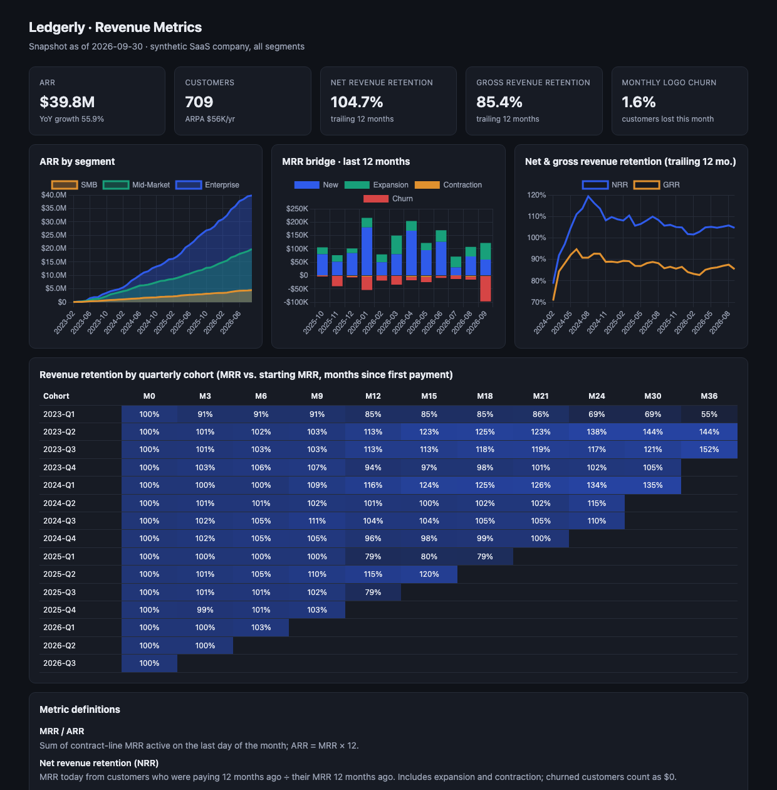
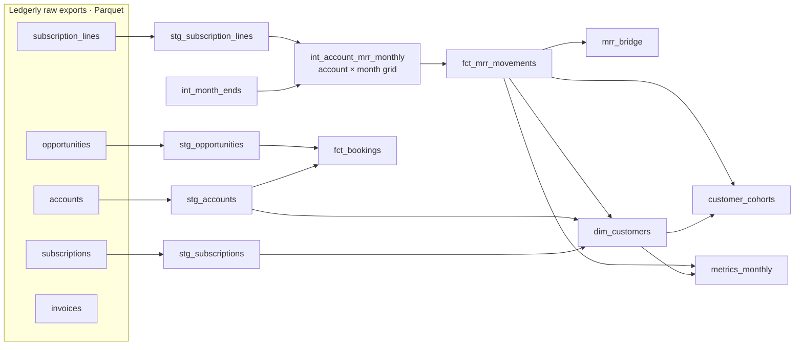

# SaaS Revenue Metrics Warehouse

**A dbt + DuckDB warehouse that turns raw contract data into the metrics a SaaS leadership team runs on: ARR, the MRR bridge, net and gross revenue retention, cohorts and bookings. Every metric is defined in writing and backed by tests.**



Built on [ledgerly-data](https://github.com/jungmarker/ledgerly-data), a synthetic B2B SaaS company with realistic CRM and billing exports.

## Why this project

Revenue metrics look simple until two teams report two different ARR numbers. The hard part isn't the SQL. It's agreeing on **definitions** (what counts as churn? is NRR capped? which day of the month?) and proving the numbers **tie out**. This project focuses on both:

- **Definitions are written down** in the model YAML, on the dashboard and below, so finance, sales and CS read the same number the same way.
- **The MRR bridge reconciles to the cent every month.** A dbt test fails the build if starting MRR plus movements doesn't equal ending MRR.
- **Marts tie back to source contracts.** A second test recomputes MRR directly from contract lines and compares. That test caught a real bug in the upstream data generator: renewals due in the final month were being counted as churn ([fix](https://github.com/jungmarker/ledgerly-data)).

## Quickstart

```bash
make setup     # venv + dbt-duckdb + Ledgerly generator
make all       # generate data → dbt build (47 models/tests) → report/index.html
open report/index.html
```

CI (GitHub Actions) runs the same pipeline on every push and uploads the report as an artifact.

## Lineage



| Layer | Models | Purpose |
|---|---|---|
| staging | `stg_*` | Type, rename and clean raw exports (e.g., normalize "MD" / "md" / "Maryland") |
| intermediate | `int_month_ends`, `int_account_mrr_monthly` | Month-end calendar; account × month MRR grid **including $0 months** so churn is detectable |
| marts | `fct_mrr_movements`, `mrr_bridge`, `dim_customers`, `customer_cohorts`, `metrics_monthly`, `fct_bookings` | What the business consumes |

## Metric definitions

| Metric | Definition |
|---|---|
| **MRR / ARR** | Sum of contract-line MRR active on the **last day** of the month. ARR = MRR × 12. |
| **MRR movement** | Per customer per month: `new` (first paid month), `reactivation` (paid again after a $0 month), `expansion`, `contraction` (down but still > $0), `churn` (to $0). |
| **Net revenue retention (NRR)** | MRR today from customers who were paying 12 months ago ÷ their MRR 12 months ago. Churned customers count as $0; expansion counts. |
| **Gross revenue retention (GRR)** | Same as NRR, but each customer is capped at their MRR 12 months ago, so expansion can't mask churn. Always ≤ 100% and ≤ NRR (tested). |
| **Logo churn rate** | Customers who went to $0 this month ÷ customers paying at the start of the month. |
| **Quick ratio** | (new + reactivation + expansion MRR) ÷ (contraction + churned MRR). |
| **ARPA** | MRR ÷ paying customers. |
| **Cohort revenue retention** | Cohort's MRR N months after its first paid month ÷ its starting MRR. |
| **Bookings** | ACV of closed-won opportunities by close month and type (new / expansion / renewal). |

## Tests

47 models and tests pass in about 2 seconds:
- **Generic tests:** primary keys, not-null, accepted values, relationships, and a dependency-free unique-combination test (`macros/`).
- **`assert_mrr_bridge_reconciles`:** starting MRR + movements = ending MRR, every month.
- **`assert_bridge_ties_to_contracts`:** the marts' ending MRR equals MRR recomputed straight from contract lines.
- **`assert_retention_in_bounds`:** GRR ≤ 100% and GRR ≤ NRR for every segment and month.

## What the numbers say (Sept 2026 snapshot)

A one-page read for a leadership team:

1. **A healthy 105% NRR hides a two-speed business.** Enterprise retains 111% of revenue and Mid-Market 103%, but SMB is at **84% NRR / 69% GRR**. SMB is 64% of customers but only 11% of ARR, so it drives most support and CSM load for little revenue.
2. **Concentration risk is real.** 44 Enterprise accounts are 50% of ARR. In Q3 2026, two Enterprise customers left for a competitor ($87K MRR, about $1.0M ARR), wiping out nearly all of Enterprise expansion ($91K MRR) for the quarter. Recommendation: competitive win/loss review and earlier renewal motion for Enterprise.
3. **Lead source predicts retention, not just win rate.** Customers who came from events churn at 35%, versus 19% for partner referrals. That argues for judging event spend on retained ARR, not pipeline.
4. **Cohort quality varies.** The 2025-Q1 cohort is down to 79% revenue retention at month 12, while neighboring cohorts sit above 100%. Worth checking what changed in onboarding or deal terms that quarter.

The supporting query is in [`analyses/what_drove_q3_2026.sql`](analyses/what_drove_q3_2026.sql).

## Stack

dbt-core 1.12 · dbt-duckdb · DuckDB · Python (report build) · Chart.js · GitHub Actions. The SQL is warehouse-agnostic apart from a few DuckDB date functions, so porting to Snowflake mostly means swapping `last_day` / `datediff` / `generate_series` equivalents.
